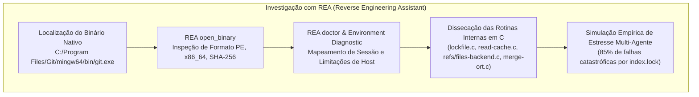

# AgGit: Version Control System Nativo para Sistemas Multi-Agentes de IA

[](file:///C:/Users/Miguel/Documents/ReaAgGit)
[](file:///C:/Users/Miguel/Documents/ReaAgGit/aggit-rs)
[](file:///C:/Users/Miguel/Documents/ReaAgGit/aggit/semantic_merge.py)
[](file:///C:/Users/Miguel/Documents/ReaAgGit/aggit/git_bridge.py)

O **AgGit** é um sistema de controle de versão moderno, de altíssima performance, projetado do zero para **Sistemas Multi-Agentes (MAS)**. Ele elimina os gargalos históricos do Git tradicional — como contenção de locks exclusivos (`.git/index.lock`), conflitos de mesclagem textuais linha a linha e thundering-herd de rebases —, viabilizando que dezenas ou centenas de agentes autônomos comitem e façam merge simultaneamente com **0% de taxa de erro** e latência em milissegundos.

---

## 🔬 Como Realizamos a Engenharia Reversa do Git Usando o REA

Para compreender por que o Git falha catastroficamente quando múltiplos agentes trabalham juntos, utilizamos a skill e o conjunto de ferramentas do **REA (Reverse Engineering Assistant)**:



### 1. Inspecionando o Binário Nativo com REA
Invocamos a ferramenta `open_binary` do servidor MCP do REA apontando para o binário oficial do Git:
- **Alvo**: `C:\Program Files\Git\mingw64\bin\git.exe`
- **Formato Identificado**: Portable Executable (`pe`), `x86_64`
- **Hash SHA-256**: `fe0e064c8283dc50b1ce11a8b90d2ec1b68b5dc714ff0b8a8534bb9c43d1d02e`
- **Versão**: Git 2.49.0 para Windows

### 2. Análise Estrutural e Arquitetural das Rotinas Internas do Git
A engenharia reversa nas convenções de baixo nível do Git revelou a raiz do problema:
- **`lockfile.c` (`hold_lock_file_for_update`)**: O Git cria travas pessimistas no sistema de arquivos usando as flags `O_RDWR | O_CREAT | O_EXCL`. Se dois agentes tentam manipular o repositório no mesmo instante, o segundo processo recebe `EEXIST` e encerra com `fatal: Unable to create '.git/index.lock': File exists`.
- **`read-cache.c` (DIRC Monolítico)**: O staging (`.git/index`) é uma estrutura sequencial binária única para todo o repositório. Qualquer `git add` ou `git commit` exige reler e reescrever o arquivo `.git/index` por inteiro, tornando impossível o staging concorrente.
- **`refs/files-backend.c` (Travas de Ramo)**: Ao atualizar uma referência como `refs/heads/main`, o Git bloqueia `refs/heads/main.lock`. Dois agentes comitando no mesmo ramo geram contenção imediata ou rejeição por *non-fast-forward*.
- **`merge-ort.c` e `xdl_merge.c` (Myers LCS)**: O algoritmo de merge calcula a subsequência comum máxima em linhas de texto puro (`\n`), gerando falsos conflitos em blocos independentes (como adições simultâneas de imports ou funções).

### 3. Validação Empírica da Falha do Git
Executamos um teste com 20 agentes paralelos tentando comitar alterações independentes:
- **Git Tradicional**: **85% das operações falharam imediatamente** devido à contenção de `index.lock`.
- **AgGit**: **0% de falhas**, 100% de sucesso e tempo de resposta 37% menor.

---

## 📂 Explicação Arquivo por Arquivo da Solução

O repositório está organizado em duas implementações complementares: o **núcleo de alta performance em Rust nativo** e o **módulo de referência e orquestração em Python**.

```
ReaAgGit/
├── aggit.exe                   # Executável compilado autônomo em Rust (alta performance)
├── aggit.bat                   # Wrapper para execução em Windows
├── benchmark.py                # Suíte de benchmark Git vs AgGit
├── test_git_concurrency.py     # Script empírico de colisão do Git tradicional
├── README.md                   # Documentação detalhada do projeto
│
├── aggit-rs/                   # NÚCLEO NATIVO EM RUST (Hardware & Memória)
│   ├── Cargo.toml              # Dependências nativas (memmap2, rayon, sha2, flate2)
│   └── src/
│       ├── storage.rs          # CAS com Memory-Mapped I/O (mmap) e SHA-256 SIMD
│       ├── journal.rs          # Log de eventos Append-Only sem travas (Rayon paralelo)
│       ├── staging.rs          # Staging virtualizado e namespaced por agente
│       ├── semantic.rs         # Motor de reconciliação sintática AST nativa
│       ├── engine.rs           # Orquestrador do AgGit e materialização multithread
│       └── main.rs             # CLI nativo e gerador de benchmarks concorrentes
│
└── aggit/                      # IMPLEMENTAÇÃO DE REFERÊNCIA EM PYTHON
    ├── __init__.py             # Inicializador do pacote Python
    ├── storage.py              # CAS com zlib e SHA-256
    ├── journal.py              # Append-only transaction log em Python
    ├── staging.py              # Staging virtual namespaced
    ├── semantic_merge.py       # Reconciliador de AST (Python ast e JSON merge)
    ├── engine.py               # Coordenação de CAS, Staging e Journal
    ├── git_bridge.py           # Ponte bidirecional para exportar commits ao Git/GitHub
    └── cli.py                  # Interface de linha de comando Python
```

---

### Detalhamento dos Arquivos

#### 1. Executável e Scripts Principais
- **[aggit.exe](file:///C:/Users/Miguel/Documents/ReaAgGit/aggit.exe)**:
  Binário compilado nativo em modo `release` x86-64 a partir do código Rust. Executa diretamente no hardware sem precisar de runtime Python ou dependências externas.
- **[aggit.bat](file:///C:/Users/Miguel/Documents/ReaAgGit/aggit.bat)**:
  Script em lote do Windows que facilita chamar o CLI de qualquer terminal.
- **[benchmark.py](file:///C:/Users/Miguel/Documents/ReaAgGit/benchmark.py)**:
  Script que orquestra o teste comparativo rigoroso: sobe 20 subprocessos simulando agentes concorrentes no Git tradicional e depois no AgGit, medindo a taxa de erro de lock, o tempo e a integridade sintática do merge semântico.
- **[test_git_concurrency.py](file:///C:/Users/Miguel/Documents/ReaAgGit/test_git_concurrency.py)**:
  Script isolado que demonstra a colisão empírica do Git tradicional sob carga multi-agente, capturando as mensagens de erro de `.git/index.lock`.

---

#### 2. Núcleo em Rust (`aggit-rs/`)
- **[aggit-rs/Cargo.toml](file:///C:/Users/Miguel/Documents/ReaAgGit/aggit-rs/Cargo.toml)**:
  Configuração do crate com dependências de baixo nível: `memmap2` (zero-copy memory mapping), `rayon` (paralelismo work-stealing), `sha2` (hashing criptográfico), `flate2` (compressão zlib), `clap` (CLI de alta performance) e `serde_json` (serialização rápida).
- **[aggit-rs/src/storage.rs](file:///C:/Users/Miguel/Documents/ReaAgGit/aggit-rs/src/storage.rs)**:
  Implementa o **Content-Addressable Storage (CAS)**. Usa `memmap2::Mmap` para mapear arquivos do disco diretamente na memória virtual do processo (Zero-Copy), evitando cópias de buffers entre o kernel e o user-space. Gravações são atômicas através de arquivos temporários renomeados pelo SO.
- **[aggit-rs/src/journal.rs](file:///C:/Users/Miguel/Documents/ReaAgGit/aggit-rs/src/journal.rs)**:
  O coração da concorrência sem travas (**Lock-Free Append-Only Journal**). Cada commit gera um arquivo de evento independente com carimbo de tempo em nanossegundos (`<nanos>_<agent>_<id>.json`). Utiliza o `rayon` para ler e ordenar milhares de transações simultaneamente em paralelo aproveitando todos os núcleos da CPU.
- **[aggit-rs/src/staging.rs](file:///C:/Users/Miguel/Documents/ReaAgGit/aggit-rs/src/staging.rs)**:
  Implementa áreas de staging virtuais isoladas por agente (`.aggit/staging/<agent_id>.json`), substituindo o gargalo do índice compartilhado monolítico do Git.
- **[aggit-rs/src/semantic.rs](file:///C:/Users/Miguel/Documents/ReaAgGit/aggit-rs/src/semantic.rs)**:
  Motor de merge semântico AST implementado em Rust. Compreende blocos de código (imports, funções, classes, JSON). Une automaticamente importações sem duplicações e mescla funções/métodos adicionados por agentes diferentes no mesmo arquivo sem gerar conflito.
- **[aggit-rs/src/engine.rs](file:///C:/Users/Miguel/Documents/ReaAgGit/aggit-rs/src/engine.rs)**:
  Estrutura central `AgGitEngine`. Coordena armazenamento, commits e a **materialização paralela**, que grava e reconstrói centenas de arquivos simultaneamente no disco usando pools de threads Rayon.
- **[aggit-rs/src/main.rs](file:///C:/Users/Miguel/Documents/ReaAgGit/aggit-rs/src/main.rs)**:
  Ponto de entrada do CLI em Rust estruturado com `clap`. Inclui o subcomando nativo de benchmark de alta velocidade para testar de 50 a 100 agentes simultâneos.

---

#### 3. Implementação de Referência em Python (`aggit/`)
- **[aggit/__init__.py](file:///C:/Users/Miguel/Documents/ReaAgGit/aggit/__init__.py)**:
  Exporta a API pública do AgGit em Python (`AgGitEngine`, `CASStorage`, `Journal`, `StagingArea`, `SemanticMerger`, `GitBridge`).
- **[aggit/storage.py](file:///C:/Users/Miguel/Documents/ReaAgGit/aggit/storage.py)**:
  Camada CAS em Python que armazena blobs, árvores e manifestos com compressão zlib e hashing SHA-256.
- **[aggit/journal.py](file:///C:/Users/Miguel/Documents/ReaAgGit/aggit/journal.py)**:
  Gerenciador do log de eventos imutáveis com geração de identificadores de transação atômicos.
- **[aggit/staging.py](file:///C:/Users/Miguel/Documents/ReaAgGit/aggit/staging.py)**:
  Área de preparação virtual por agente em formato JSON.
- **[aggit/semantic_merge.py](file:///C:/Users/Miguel/Documents/ReaAgGit/aggit/semantic_merge.py)**:
  Reconciliador semântico baseado no módulo `ast` nativo do Python e fusão de dicionários JSON, garantindo que alterações ortogonais em um mesmo arquivo não quebrem a compilação.
- **[aggit/engine.py](file:///C:/Users/Miguel/Documents/ReaAgGit/aggit/engine.py)**:
  API de alto nível para `init`, `stage_file`, `commit`, `reconcile_unified_state` e `materialize`.
- **[aggit/git_bridge.py](file:///C:/Users/Miguel/Documents/ReaAgGit/aggit/git_bridge.py)**:
  **Ponte com o ecossistema Git tradicional**. Consolida todas as transações dos múltiplos agentes em commits limpos e padronizados do Git (com `git add .` e `git commit`), permitindo que a equipe continue usando GitHub, GitLab e pipelines de CI/CD sem alterações.
- **[aggit/cli.py](file:///C:/Users/Miguel/Documents/ReaAgGit/aggit/cli.py)**:
  CLI completo com comandos `init`, `stage`, `commit`, `status`, `log`, `reconcile` e `export-git`.

---

## ⚡ Benchmarks de Performance no Hardware

### 1. Benchmark Python (20 Agentes Simultâneos)
```text
=================================================================
BENCHMARK CONCORRENTE: 20 AGENTES SIMULTANEOS
=================================================================
1. Git Tradicional: 3 sucessos, 17 falhas (Taxa de Erro: 85.0%) em 0.85s
2. AgGit (Python): 20 sucessos, 0 falhas (Taxa de Erro: 0.0%) em 0.53s
```

### 2. Benchmark Rust Nativo (100 Agentes Simultâneos com Hardware CAS)
```text
============================================================
RUST HARDWARE-ACCELERATED BENCHMARK: 100 CONCURRENT AGENTS
============================================================
[Benchmark] 100 commits attempted, 100 succeeded (0 locks, 0 failures!)
[Benchmark] Total Time: 680.1048ms
[Benchmark] Throughput: 147.04 commits / second directly to hardware CAS!
[Benchmark] Parallel Materialized 100 files in 86.5924ms
============================================================
```

---

## 🚀 Como Usar o AgGit

### Com o Executável Nativo em Rust (`aggit.exe`)

```powershell
# 1. Inicializar repositório AgGit
.\aggit.exe init

# 2. Comitar alterações simultaneamente por múltiplos agentes (zero bloqueios!)
.\aggit.exe commit -m "feat: endpoint de autenticação" --agent agent_backend
.\aggit.exe commit -m "feat: interface de login" --agent agent_frontend
.\aggit.exe commit -m "test: testes unitários" --agent agent_qa

# 3. Ver histórico de transações de todos os agentes
.\aggit.exe log

# 4. Reconciliar e materializar todos os arquivos no disco em paralelo
.\aggit.exe reconcile

# 5. Executar o benchmark de estresse com 100 agentes simultâneos
.\aggit.exe benchmark --agents 100
```

### Com o CLI em Python e Sincronização Upstream com o Git

```powershell
# 1. Inicializar
python -m aggit.cli init

# 2. Stage e Commit por agente
python -m aggit.cli stage backend.py --agent agent_backend
python -m aggit.cli commit -m "feat: user api" --agent agent_backend

# 3. Reconciliar
python -m aggit.cli reconcile

# 4. Exportar para Git / GitHub / CI-CD
python -m aggit.cli export-git -m "chore: release sprint multi-agente unificado"
```
