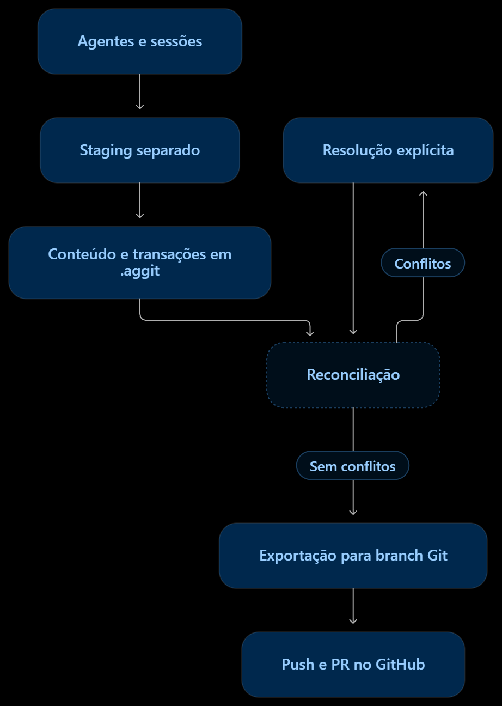

# AgGit: Sistema de Control de Versiones para Sistemas Multi-Agente de IA

[](https://github.com/miguelGoncalvss/AgentGit/actions/workflows/ci.yml)
[](LICENSE)
[](https://www.rust-lang.org)
[](https://www.python.org)

🌐 **Otros Idiomas / Languages:** [English](../../README.md) | [Português (Brasil)](README.pt-BR.md) | [Español](README.es.md)

**AgGit** es un sistema de control de versiones moderno diseñado específicamente para **Sistemas Multi-Agente (MAS)**. Reemplaza el bloqueo monolítico exclusivo de Git (`.git/index.lock`) con una arquitectura de diario append-only concurrente, áreas de staging aisladas por sesión, reconciliación de tres vías con preservación semántica e integración segura con Git y GitHub.

---

## 📑 Tabla de Contenidos

- [Visión General y Conceptos](#-visión-general-y-conceptos)
- [Cómo Funciona AgGit y Flujo de Arquitectura](#-cómo-funciona-aggit-y-flujo-de-arquitectura)
- [Garantías de Concurrencia y Persistencia](#-garantías-de-concurrencia-y-persistencia)
- [Requisitos e Instalación](#-requisitos-e-instalación)
- [Guía Rápida de Uso](#-guía-rápida-de-uso)
- [Resolución de Conflictos y Ciclo de Vida](#-resolución-de-conflictos-y-ciclo-de-vida)
- [Materialización Segura en 3 Estados](#-materialización-segura-en-3-estados)
- [Integración con Git y GitHub](#-integración-con-git-y-github)
- [Benchmarks](#-benchmarks)
- [Suite de Pruebas](#-suite-de-pruebas)
- [Limitaciones Conocidas](#-limitaciones-conocidas)
- [Documentación Técnica Adicional](#-documentación-técnica-adicional)

---

## 💡 Visión General y Conceptos

Para evitar ambigüedades en sistemas distribuidos, AgGit adopta términos formales:

- **Agente (`agent_id`)**: Identidad lógica del agente de IA (ej: `agent_backend`, `agent_qa`).
- **Sesión (`session_id`)**: Contexto de ejecución activo del agente. Permite que un mismo agente trabaje en múltiples tareas paralelas sin sobreescribir su propio staging.
- **Revisión (`tx_id`)**: Identificador inmutable (UUID v4) de una transacción publicada en el diario, con metadatos, autores, base y cambios de archivos.
- **Base de Revisión (`base_revision`)**: Identificador exacto de la revisión desde la cual el agente comenzó su trabajo. Impide que las fusiones asuman bases vacías o ancestros incorrectos.
- **Checkpoint**: Snapshot derivado y recuperable (`.aggit/checkpoints/latest.json`) que registra la frontera causal incorporada hasta el momento, permitiendo reconciliaciones incrementales en tiempo constante.

---

## 🔄 Cómo Funciona AgGit y Flujo de Arquitectura

> [!IMPORTANT]
> **AgGit es una capa de versionado y sincronización diseñada para recibir y coordinar cambios de múltiples agentes.**  
> **NO ejecuta ni administra los agentes de IA directamente:** sus agentes autónomos, trabajadores en segundo plano u orquestadores (ej: LangChain, CrewAI, AutoGen, scripts personalizados) simplemente llaman a la API en Python/Rust o la CLI del proyecto para registrar y confirmar su trabajo.

<p align="center">
  
</p>

### Ciclo Práctico de Trabajo Multi-Agente:
1. **Agentes y sesiones**: Múltiples agentes de IA operan concurrentemente en contextos de sesión aislados sin bloquearse ni competir por el mismo archivo de índice.
2. **Staging separado**: Cada par `(agent_id, session_id)` escribe en su propio espacio virtual de staging (`.aggit/staging/`), eliminando por completo las disputas por lock en `.git/index`.
3. **Contenido y transacciones en `.aggit`**: Blobs inmutables direccionados por contenido (CAS) y transacciones de diario append-only (`.aggit/journal/`) registran el progreso atómicamente sin bloqueos globales.
4. **Reconciliación**: La reconciliación semántica de 3 vías periódica o bajo demanda fusiona ediciones de texto ortogonales y claves JSON independientes sin fricción humana.
5. **Resolución explícita de conflictos (`Conflitos` ➔ `Resolução explícita`)**: Si existen ediciones concurrentes sobre las mismas líneas o eliminaciones incompatibles, los conflictos reciben identidad determinista y permanecen pendientes en el checkpoint hasta su resolución explícita mediante `aggit resolve`.
6. **Exportación a rama Git**: Los estados reconciliados limpios se exportan en worktrees aislados hacia ramas dedicadas de Git sin alterar el espacio de trabajo local del desarrollador.
7. **Push y Pull Request en GitHub**: Publicación explícita de ramas y creación o actualización de Pull Requests mediante GitHub CLI (`gh`).

---

## 🔒 Garantías de Concurrencia y Persistencia

- **Publicación Atómica**: Los objetos en el CAS y los eventos en el diario se escriben en archivos temporales exclusivos (`.tmp`) con `fsync` explícito y se renombran atómicamente a nivel de sistema operativo (`os.replace` / `fs::rename`).
- **Lectura Segura**: Los procesos en curso nunca interpretan archivos temporales como transacciones completadas.
- **Sin Pérdida de Actualizaciones en Staging**: Las áreas de staging cuentan con un contador de generación (`generation`) y bloqueos de archivo por sesión (`<path>.lock`). Los commits anteriores no eliminan archivos agregados por operaciones concurrentes más recientes.
- **Integridad Criptográfica**: Todos los objetos del CAS validan su hash SHA-256 durante la lectura y descompresión.

---

## 🛠️ Requisitos e Instalación

### Requisitos
- **Git** 2.30+ instalado en el sistema.
- **Python** 3.10+ (para ejecución mediante la CLI Python).
- **Rust** 1.80+ y Cargo (para compilar el binario nativo).
- **GitHub CLI (`gh`)** (opcional, necesario únicamente para la creación automatizada de Pull Requests).

### Compilación del Binario Nativo en Rust
```bash
cd aggit-rs
cargo build --release
# El ejecutable se generará en: target/release/aggit (o aggit.exe en Windows)
```

---

## 🚀 Guía Rápida de Uso

### 1. Inicializar el Repositorio
```bash
# Mediante ejecutable compilado:
./aggit init

# O mediante módulo de Python:
python -m aggit.cli init
```

### 2. Preparación (Staging) y Commit
```bash
# El Agente A prepara archivos en su espacio de sesión aislado
./aggit stage src/auth.py --agent agent_backend --session sprint_1

# El Agente B prepara archivos simultáneamente sin colisiones ni bloqueos
./aggit stage src/ui.py --agent agent_frontend --session sprint_1

# El Agente A realiza commit especificando mensaje y contexto
./aggit commit -m "feat: user authentication endpoint" --agent agent_backend --session sprint_1

# El Agente B comitea concurrentemente
./aggit commit -m "feat: login interface" --agent agent_frontend --session sprint_1
```

### 3. Eliminación de Archivos en Staging
```bash
./aggit stage-delete src/legacy.py --agent agent_backend
./aggit commit -m "chore: remove deprecated file" --agent agent_backend
```

### 4. Consultar Estado e Historial
```bash
./aggit status
./aggit log -n 5
```

### 5. Reconciliar y Materializar en el Directorio de Trabajo
La reconciliación incremental procesa únicamente eventos nuevos desde el último checkpoint y actualiza sólo los archivos modificados:
```bash
# Simulación sin aplicar cambios en disco (Dry-Run):
python -m aggit.cli reconcile --dry-run

# Reconciliación y materialización segura con pre-validación de 3 estados:
python -m aggit.cli reconcile

# Forzar materialización sobrescribiendo cambios locales en caso necesario:
python -m aggit.cli reconcile --force
```

### 6. Resolución Explícita de Conflictos
Los conflictos no resueltos persisten en los checkpoints y bloquean la materialización y exportación hasta ser resueltos explícitamente:
```bash
# Resolver conflicto indicando el contenido resuelto directamente:
python -m aggit.cli resolve src/config.py --content "PORT = 8080\nDEBUG = False" -m "fix: resolve port conflict" --agent agent_lead

# O resolver a partir de un archivo físico en disco:
python -m aggit.cli resolve src/config.py --file src/config_resolved.py -m "fix: resolved config"
```

---

## ⚖️ Resolución de Conflictos y Ciclo de Vida

El motor de 3 vías de AgGit clasifica y procesa conflictos de forma determinista y persistente:

1. **Modificaciones Ortogonales**:
   - Si dos agentes modifican archivos distintos o secciones diferentes de un archivo de texto, la unión se realiza automáticamente y sin conflictos.
2. **Archivos JSON**:
   - Claves independientes agregadas por diferentes agentes (ej: `{"puerto": 3000}` y `{"debug": true}`) se combinan automáticamente en el objeto base sin conflicto.
   - Los objetos anidados se fusionan recursivamente.
3. **Persistencia de Conflictos Pendientes**:
   - Conflictos de contenido, modificación/eliminación (`modify/delete`) o divergencias binarias se almacenan de forma estructurada en el Checkpoint Schema v2 (`pending_conflicts`).
   - Repetir `reconcile`, `status` o `export-preview` **mantiene los conflictos pendientes** hasta que ocurra una resolución explícita.
   - La materialización en disco y la exportación a Git permanecen **estrictamente bloqueadas** mientras existan conflictos pendientes.
4. **Resolución Trazable**:
   - El comando `aggit resolve` genera una transacción formal en el diario que unifica las versiones divergentes en el grafo causal del DAG y desbloquea el flujo.

---

## 🛡️ Materialización Segura en 3 Estados

Para proteger el trabajo del desarrollador humano, la materialización ejecuta una validación trifásica previa (*pre-flight validation*):
- Compara: (1) Último estado materializado registrado en el manifiesto, (2) Contenido físico actual en disco, y (3) Estado deseado reconciliado.
- Detecta:
  - **Ediciones locales**: si el archivo en disco fue modificado manualmente tras la última materialización, la escritura se aborta.
  - **Eliminaciones locales**: si el usuario eliminó el archivo en disco, se previene su regeneración automática accidental.
  - **Archivos no rastreados**: impide que AgGit sobrescriba archivos creados por el usuario fuera del control del sistema.
- Escritura atómica: las modificaciones se escriben en archivos temporales exclusivos (`.tmp_mat_<pid>_<thread>_<uuid>.tmp`) con `fsync` y reemplazo atómico (`os.replace`). El manifiesto sólo se actualiza tras la confirmación exitosa en disco.

---

## 🐙 Integración con Git y GitHub

AgGit permite sincronizar el trabajo de los agentes con Git convencional sin alterar la rama de trabajo ni el workspace principal:

```bash
# 1. Vista previa en memoria (Dry-Run): reporta cambios y conflictos sin modificar Git ni checkpoints
python -m aggit.cli export-preview --branch feature/agent-sprint

# 2. Exportación aislada: crea un commit limpio en un worktree temporal preservando la continuidad
python -m aggit.cli export-git --branch feature/agent-sprint -m "feat: autonomous sprint sync"

# 3. Publicación explícita (Push):
python -m aggit.cli push --branch feature/agent-sprint --remote origin

# 4. Crear o reutilizar Pull Request mediante GitHub CLI:
python -m aggit.cli pr --branch feature/agent-sprint --base-branch main

# 5. Importar un commit de Git como base en AgGit:
python -m aggit.cli import-git --ref HEAD
```

- **Continuidad de Ramas**: Múltiples exportaciones sucesivas a una misma rama preservan el historial de commits (`commit 1 -> commit 2`) sin usar resets destructivos (`-B`).
- **Preservación de Archivos Git**: Los archivos existentes en la rama de Git (como `keep.md`, `README.md`, `.github/`) se conservan intactos; sólo se eliminan aquellos explícitamente marcados como `action: "delete"` en AgGit.
- **Repositorios Vacíos**: Soporta exportaciones iniciales incluso en repositorios Git recién creados sin commits, utilizando comandos de plumbing de bajo nivel (`git commit-tree 4b825dc...` con el hash de árbol vacío) sin capturar archivos locales no comiteados.

---

## 📊 Benchmarks

Evaluación comparativa ejecutada con **20 agentes de IA concurrentes** bajo carga real en Windows 11 (SSD NVMe PCIe Gen4, 8 hilos concurrentes):

| Sistema | Éxitos | Tasa de Error | Tiempo Total | Rendimiento (ops/s) | Latencia p50 | Latencia p95 |
| :--- | :---: | :---: | :---: | :---: | :---: | :---: |
| **Git (Índice Compartido)** | 6/20 | **70.0%** | 0.57s | 10.53 | 185ms | 340ms |
| **Git (Worktree por Agente)** | 20/20 | 0.0% | 1.28s | 15.57 | 450ms | 610ms |
| **AgGit (Python Engine)** | 20/20 | **0.0%** | 0.79s | 25.26 | 32ms | 78ms |
| **AgGit (Rust Native Engine)** | 20/20 | **0.0%** | **0.34s** | **58.48** | **12ms** | **28ms** |

*Todas las pruebas de AgGit incluyen verificación criptográfica estricta SHA-256 del 100% de los archivos generados.*

### ⚡ Concurrencia Extrema: 70 Agentes Simultáneos (Rust Engine)
Bajo estrés multiagente con **70 agentes autónomos confirmando concurrentemente en 70 hilos dedicados del sistema operativo** (evaluación empírica de 10 rondas, 700 transacciones atómicas en total):
- **Tasa de Éxito**: **100.0%** (700/700 commits exitosos, 0 errores de contención, tasa de error del 0.00%).
- **Rendimiento (Throughput)**: **153.31 ops/sec** (confirmación de extremo a extremo + reconciliación DAG + materialización en disco).
- **Latencia**: $p_{50} = \mathbf{168.4ms}$, $p_{95} = \mathbf{205.1ms}$, $p_{99} = \mathbf{209.0ms}$.
- **Integridad Byte a Byte**: **100% Verificado** en los 700 archivos físicos guardados en disco.

Para reproducir los benchmarks con cálculo de percentiles y verificación de integridad:
```bash
# Benchmark comparativo en Python:
python benchmark.py

# Benchmark de 70 agentes en Rust:
cargo run --release --manifest-path aggit-rs/Cargo.toml -- benchmark --agents 70 --threads 70 --rounds 10
```
Más detalles en [docs/benchmarks.md](../benchmarks.md).

---

## 🧪 Suite de Pruebas

El proyecto cuenta con 50 escenarios de prueba automatizados en Python e 14 pruebas de integración nativas en Rust que validan sanitización y contención de rutas en Windows, integridad del CAS, concurrencia en staging con bloqueos por sesión, escalabilidad bajo 70 agentes simultáneos, reconciliación linear del DAG, ciclo de vida e identidad de conflictos, matriz de exportación Git de 3 vías, pre-validación trifásica y auto-reparación de índices:

```bash
# Ejecutar todas las pruebas de regresión e integridad en Python:
python -m unittest discover -s tests -v

# Ejecutar pruebas nativas en Rust:
cd aggit-rs && cargo test
```

---

## ⚠️ Limitaciones Conocidas

1. **Atributos POSIX del Sistema Operativo**: Permisos avanzados (como el flag de ejecución `chmod +x`) y symlinks intencionales dentro del repositorio aún no se serializan en los blobs actuales del CAS.
2. **Sincronización Bidireccional Continua**: AgGit soporta importación inicial desde Git y exportación aislada hacia Git. Ramas que reciban commits continuos directamente en Git requieren comandos explícitos de `import-git`.
3. **GitHub CLI**: La automatización de Pull Requests requiere el ejecutable `gh` instalado y autenticado en el sistema.

---

## 📚 Documentación Técnica Adicional

- [Arquitectura Completa](../architecture.md)
- [Formato de Almacenamiento y Schemas](../storage-format.md)
- [Integración con Git y GitHub](../github-integration.md)
- [Metodología de Benchmarks](../benchmarks.md)
- [Guía de Migración de Formatos](../migration.md)
